<p align="center">
  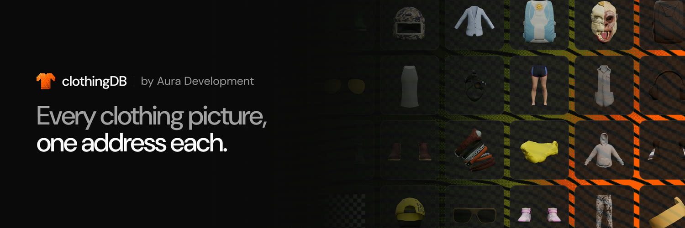
</p>

<p align="center">
  <b>Every GTA clothing picture, for male and female, at an address that never changes.</b><br>
  Free to use, source available, by Aura Development.
</p>

<p align="center">
  <a href="https://clothingdb.auradevelopment.xyz">Website</a> ·
  <a href="https://clothingdb.auradevelopment.xyz/docs">Docs</a> ·
  <a href="https://discord.gg/zvR4ACaJvR">Discord</a> ·
  <a href="https://store.auradevelopment.xyz">Tebex store</a> ·
  <a href="https://auradevelopment.xyz">Web agency</a>
</p>

---

## Contents

- [What it is](#what-it-is)
- [Previews](#previews)
- [Features](#features)
- [Picture addresses](#picture-addresses)
- [Use cases](#use-cases)
- [Tech stack](#tech-stack)
- [Project structure](#project-structure)
- [Contributing](#contributing)
- [For maintainers](#for-maintainers)
- [Security](#security)
- [License](#license)
- [Credits](#credits)

## What it is

clothingDB is a picture of every clothing item, prop and face overlay in GTA V
for the male and female ped. Every item, in every colour, as the piece on its
own and worn by the ped. Each picture lives at a fixed address you can put
anywhere an image goes: game UIs, websites, wikis, Discord bots.

- **Pictures**: 76,788 (38,394 items and colours, each in two kinds)
- **Slots**: 28, across clothing, props, and face and body
- **Peds**: Male and female
- **Game build**: 3889
- **Cost**: Free. No key, no account, no sign-up

## Previews

<p align="center">
  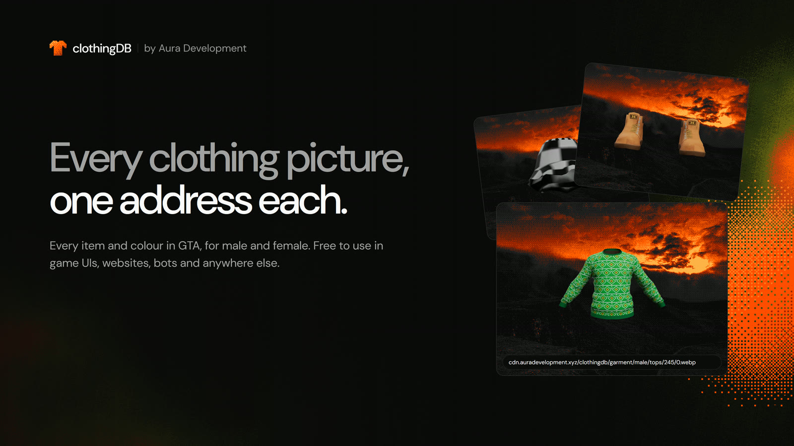
</p>

<table>
  <tr>
    <td width="50%">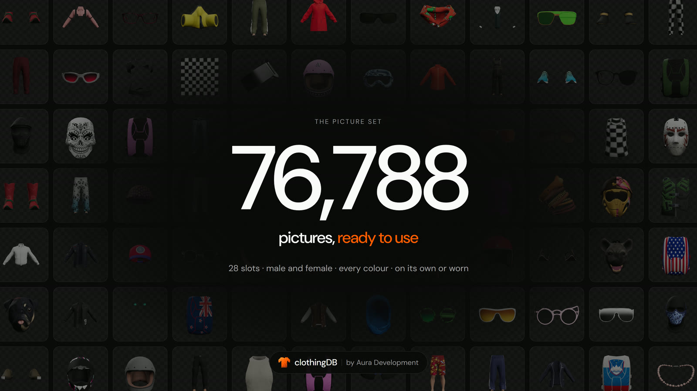</td>
    <td width="50%">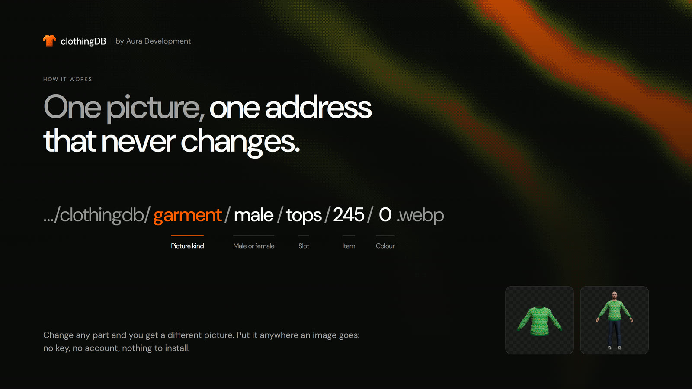</td>
  </tr>
  <tr>
    <td width="50%">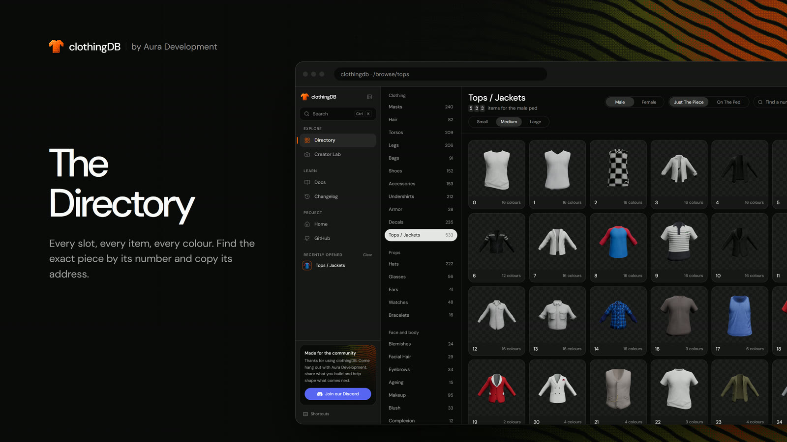</td>
    <td width="50%">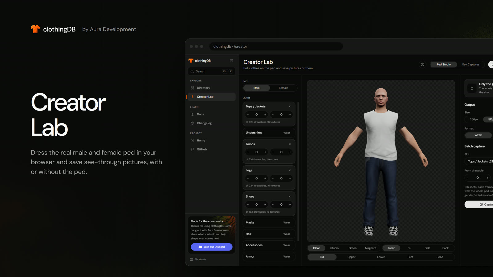</td>
  </tr>
  <tr>
    <td width="50%">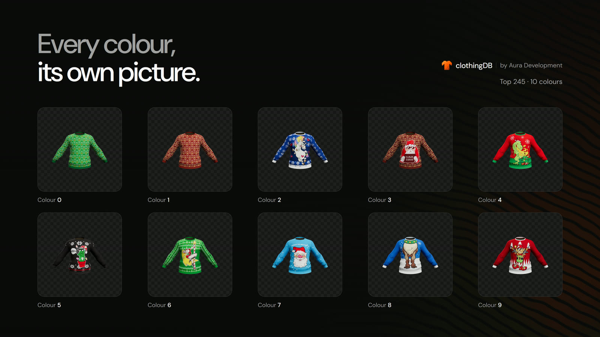</td>
    <td width="50%">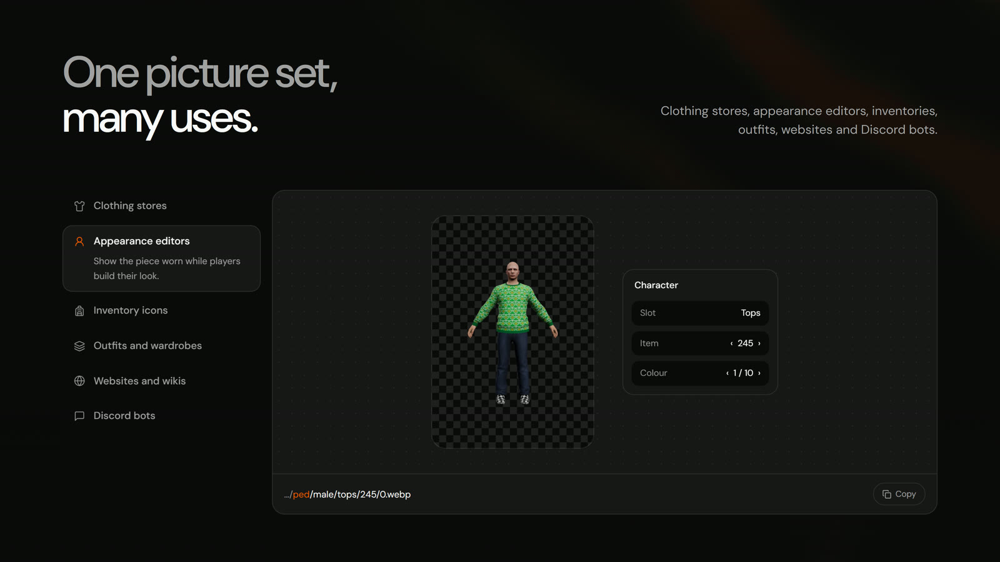</td>
  </tr>
  <tr>
    <td width="50%">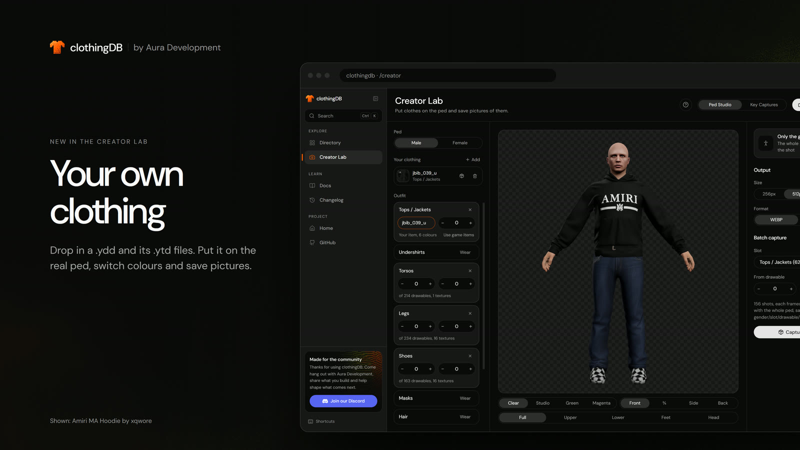</td>
    <td width="50%">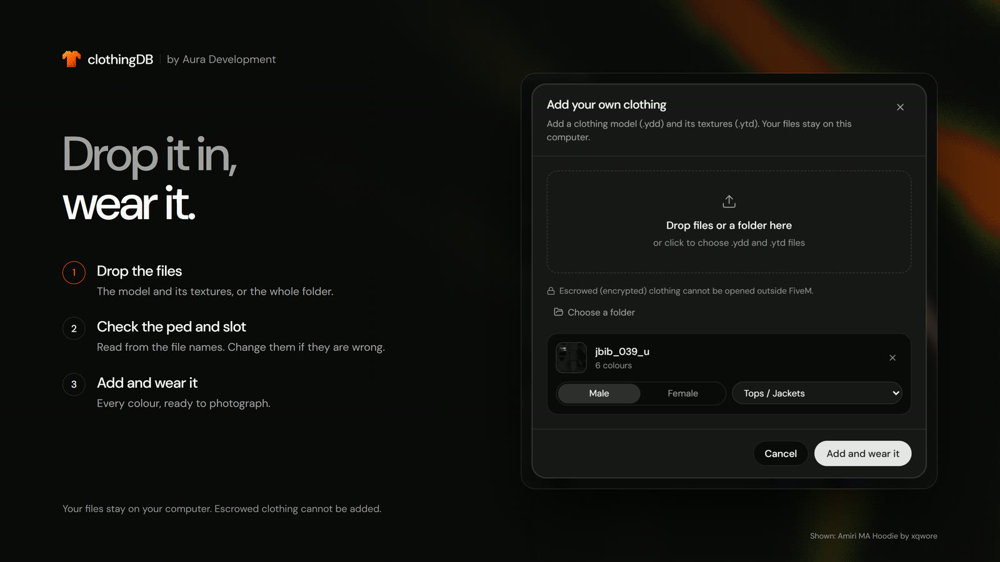</td>
  </tr>
  <tr>
    <td width="50%">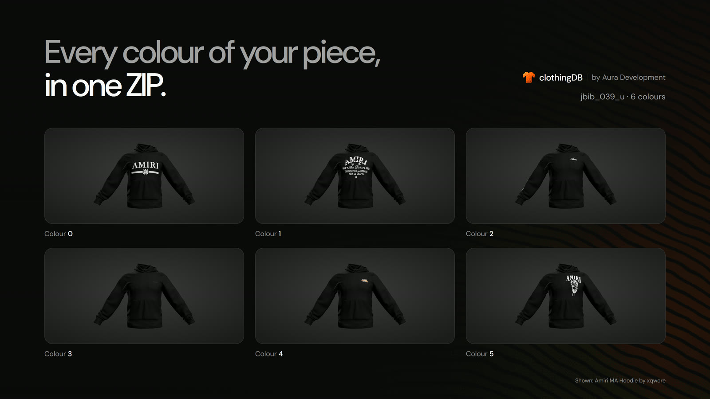</td>
    <td width="50%">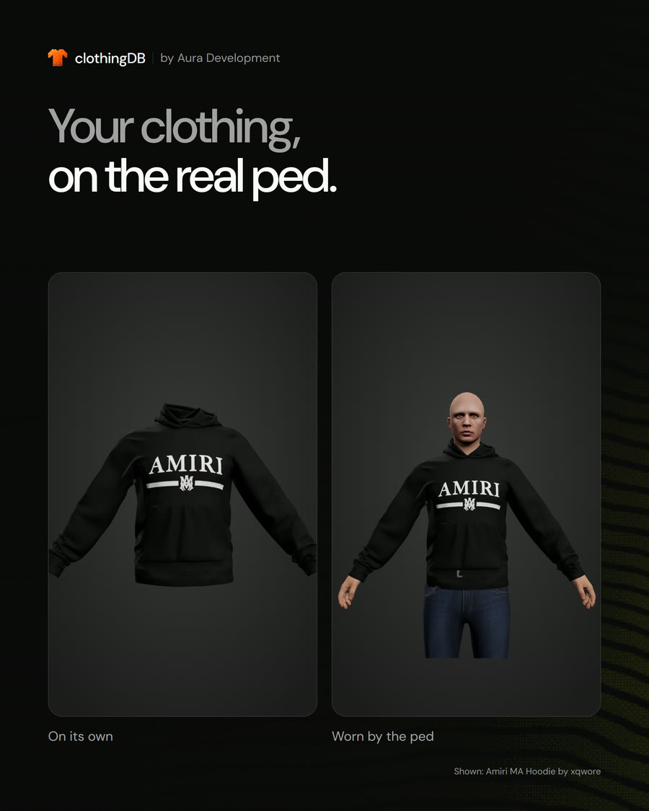</td>
  </tr>
</table>

<p align="center">
  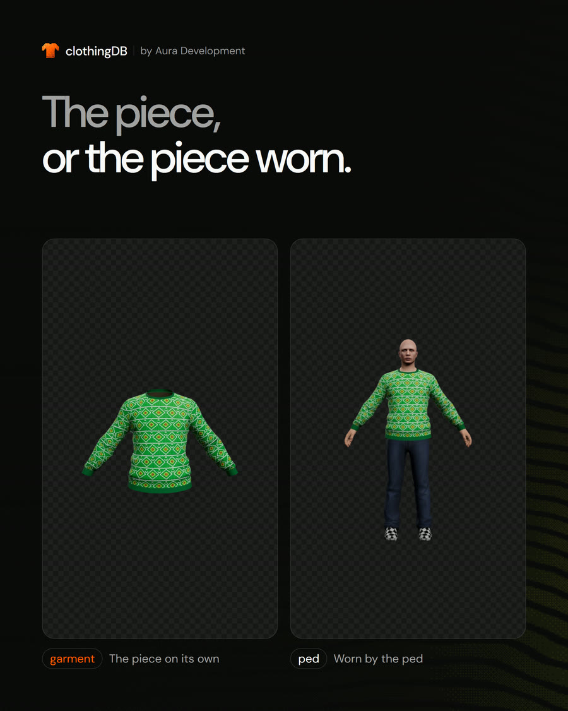
</p>

## Features

### Directory

Browse all 28 slots, for male and female. Find any item by its number, see every
colour, switch between the piece on its own and the piece worn, and copy its
picture address in one click.

### Picture CDN

Every picture is a plain image address on a fast CDN. Addresses never change,
even when the game adds new clothes, and browsers are told to keep each picture
for a year.

### Creator Lab

A photo studio for GTA clothing that runs in the browser, with the real male
and female ped from the game:

- Dress the ped in any of the 11 body clothing slots and turn it to any angle.
- **Only the garment** hides the body and every other item, for a clean picture
  of one piece.
- See-through, studio, green or magenta backgrounds; front, ¾, side or back;
  full body, upper, lower, feet or head framing; 256 to 1024 pixels; WebP or PNG.
- **Batch capture** photographs a whole range of items in every colour and
  hands you one ZIP, laid out like the picture addresses.
- **Your own clothing**: drop in a clothing model (.ydd) and its textures (.ytd),
  put it on the ped and photograph it like the game's own clothing, every colour
  in one ZIP. Files are read in the browser and never uploaded. Escrowed
  (encrypted) clothing cannot be opened outside FiveM, so it is turned away.

<p align="center">
  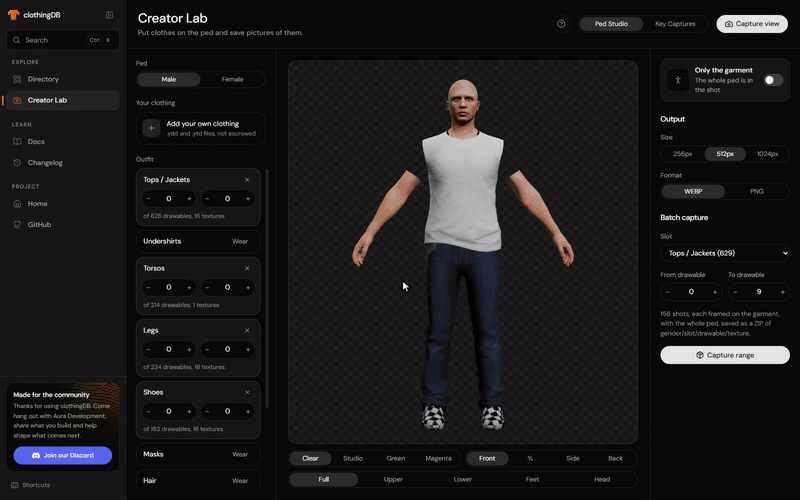
</p>

### Key captures

Drop in your own screenshots taken in game on a green or magenta background.
clothingDB removes the background, frames the clothing, names each picture and
exports them in the same layout as the CDN. Nothing leaves your computer.

### Docs

Guides for picture addresses, every slot, and every part of the Creator Lab.

## Picture addresses

```txt
https://cdn.auradevelopment.xyz/clothingdb/{kind}/{gender}/{slot}/{item}/{colour}.webp
```

| Part     | What it is                                            | Example   |
| -------- | ----------------------------------------------------- | --------- |
| `kind`   | `garment` for the piece on its own, `ped` for it worn | `garment` |
| `gender` | `male` or `female`                                    | `male`    |
| `slot`   | The slot's name in the address                        | `tops`    |
| `item`   | The item's number, the same one the game uses         | `245`     |
| `colour` | Which colour of the item, from 0                      | `0`       |

```txt
https://cdn.auradevelopment.xyz/clothingdb/garment/male/tops/245/0.webp   the piece on its own
https://cdn.auradevelopment.xyz/clothingdb/ped/male/tops/245/0.webp       worn by the ped
```

Use it like any image:

```html

```

## Use cases

| Use                              | Picture kind |
| -------------------------------- | ------------ |
| Clothing stores in game          | `garment`    |
| Appearance and character editors | `ped`        |
| Inventory icons                  | `garment`    |
| Outfits and wardrobes            | `ped`        |
| Websites and wikis               | `garment`    |
| Discord bots                     | `garment`    |

## Tech stack

| Area       | Tools                                                                    |
| ---------- | ------------------------------------------------------------------------ |
| Site       | [Waku](https://waku.gg) (React 19 server components) on Vite, TypeScript |
| Styling    | Tailwind CSS 4, DM Sans, a WebGL dither shader for the pixel art         |
| Docs       | [Fumadocs](https://fumadocs.dev), MDX in `content/docs`                  |
| 3D         | three.js: glTF peds and see-through captures                             |
| Motion     | `motion`                                                                 |
| Hosting    | Cloudflare Workers (site), Cloudflare R2 (pictures and peds)             |
| Ped export | .NET 8, C# 12, CodeWalker.Core, SharpGLTF, MSTest                        |
| Rendering  | Playwright driving Microsoft Edge                                        |
| Quality    | Biome, Vitest, typos, lefthook, commitlint, Dependabot, lychee           |

## Project structure

```txt
content/docs/            Docs pages (MDX); sidebar order in meta.json
public/                  Static files: favicon, social card, art
scripts/                 Build, render, upload, deploy and preview scripts
src/
  pages/                 Waku file router
    _root.tsx            <html> shell, fonts, metadata
    index.tsx            /             homepage
    (app)/               /browse, /creator, /changelog (sidebar layout)
    docs/                /docs         Fumadocs layout and pages
    render.tsx           /render       render target for the picture pipeline
    _api/                /health, /manifest, /api/search
  components/
    site/                homepage: nav, footer, FAQ, art, home/ sections
    directory/           the Directory
    studio/              Creator Lab: ped studio, viewport, key captures, render harness
    shell/               app sidebar and command palette
    changelog/  docs/    changelog timeline, Fumadocs wiring
    ui/                  button, dither, flip counter, logo, tour
  lib/                   clothing data and addresses, chroma keying, utilities
  styles.css             Tailwind entry and design tokens
tools/ped-export/        .NET 8 ped exporter (CodeWalker), with tests
.github/                 CI, deploy and link-check workflows, Dependabot, README assets
```

## Contributing

Contributions are welcome. You do not need a Cloudflare account, keys or access
to any clothingDB service: everything runs on your own computer.

```bash
bun install
bun run hooks
bun run dev
```

The site opens on http://localhost:3000 with pictures from the public CDN. Run
`bun run check` before opening a pull request. Commits and pull request titles
follow [Conventional Commits](https://www.conventionalcommits.org), for example
`feat(studio): add an only-the-garment switch`.

Read [CONTRIBUTING.md](CONTRIBUTING.md) for the full guide: setup, tools, code
style, commit scopes and how changes go live.

## For maintainers

<details>
<summary><b>Scripts</b></summary>

| Script                                      | What it does                                                           |
| ------------------------------------------- | ---------------------------------------------------------------------- |
| `bun run dev`                               | Development server on port 3000                                        |
| `bun run build` / `bun run start`           | Production build, served on port 8080                                  |
| `bun run check`                             | Typecheck, lint, tests and build, the same as CI                       |
| `bun run lint` / `bun run format`           | Biome check, or check and fix                                          |
| `bun run test` / `bun run test:watch`       | Vitest unit tests                                                      |
| `bun run typos`                             | Spell check                                                            |
| `bun run hooks`                             | Install the git hooks                                                  |
| `bun run deploy <staging\|production>`      | Build for Cloudflare Workers and deploy (`--dry`, `--preview <alias>`) |
| `bun run export-peds` / `export-overlays`   | Export clothing, props and overlays from GTA V                         |
| `bun run test-exporter`                     | The exporter's MSTest suite                                            |
| `bun run serve-peds`                        | Serve the exported peds on port 3100                                   |
| `bun run render-cdn`                        | Render every picture and upload it to R2                               |
| `bun run upload-cdn` / `upload-peds`        | Upload rendered pictures or the ped export to R2                       |
| `bun run build-manifest -- --build <build>` | Rebuild the item list from what is in the bucket                       |

</details>

<details>
<summary><b>Environment</b></summary>

Copy `.env.example` to `.env`. `.env` and `*.local` files are git-ignored.

| Variable                                                    | Used by        | Purpose                                                                     |
| ----------------------------------------------------------- | -------------- | --------------------------------------------------------------------------- |
| `WAKU_PUBLIC_CDN_BASE`                                      | site           | Folder holding the `garment` and `ped` sets. Defaults to the clothingDB CDN |
| `WAKU_PUBLIC_PEDS_BASE`                                     | Creator Lab    | Where the peds load from                                                    |
| `R2_ACCOUNT_ID`, `R2_ACCESS_KEY_ID`, `R2_SECRET_ACCESS_KEY` | render, upload | R2 API token (Object Read & Write, one bucket)                              |
| `R2_BUCKET`, `R2_PREFIX`                                    | render, upload | Bucket and folder                                                           |
| `CDN_PUBLIC_BASE`                                           | render, upload | Public address of that folder                                               |

</details>

<details>
<summary><b>Picture pipeline</b></summary>

1. **Export** the peds from a legacy GTA V install on Windows with
   `bun run export-peds` and `bun run export-overlays`. Output goes to
   `%USERPROFILE%\clothingdb-peds`. See [tools/ped-export](tools/ped-export/README.md).
2. **Serve** them with `bun run serve-peds`, then build and start the site.
3. **Render and upload** with `bun run render-cdn`. It opens `/render` in Edge,
   photographs every item and colour in both kinds and uploads each picture to
   R2 with a one-year cache. Already uploaded pictures are skipped, so it resumes.
4. **Upload the peds** for the Creator Lab with `bun run upload-peds`.
5. **Update the item list** with `bun run build-manifest -- --build <game build>`.

</details>

<details>
<summary><b>Deploys</b></summary>

| When                                | Where                                      |
| ----------------------------------- | ------------------------------------------ |
| A pull request from this repository | A preview link, posted on the pull request |
| CI passes on `main`                 | Staging (private, not indexed)             |
| A `v*` release is published         | Production                                 |

The workflows need the `CLOUDFLARE_API_TOKEN` secret and the
`CLOUDFLARE_ACCOUNT_ID` variable. To deploy by hand, log in once with
`node node_modules/wrangler/bin/wrangler.js login`, then `bun run deploy staging`.

</details>

## Security

Please report security issues privately, not in public issues. See
[SECURITY.md](SECURITY.md).

## License

clothingDB is licensed under the [MIT License with the Commons Clause](LICENSE)
© 2026 Aura Development.

- **You can** use, copy, change and share clothingDB and its pictures for
  anything, including inside paid servers, stores and projects.
- **You cannot** sell it: not clothingDB itself, a copy or changed version of
  it, the pictures, or any product or service whose value comes entirely or
  mostly from them.

The [LICENSE](LICENSE) file is the legal text; this summary does not replace it.

GTA V and its assets belong to Rockstar Games. clothingDB is not affiliated with
or endorsed by Rockstar Games or Take-Two Interactive.

## Credits

- Chroma keying in Key captures is adapted from
  [uz_AutoShot](https://github.com/uz-scripts/uz_AutoShot) (Apache-2.0). See
  [NOTICE](NOTICE).
- Game files are read with [CodeWalker](https://github.com/dexyfex/CodeWalker).
- The hoodie in the custom clothing previews is the Amiri MA Hoodie by xqwore.

<p align="center"><sub>Made by <a href="https://auradevelopment.xyz">Aura Development</a> for the FiveM community.</sub></p>
